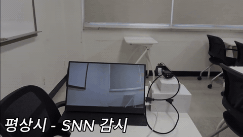
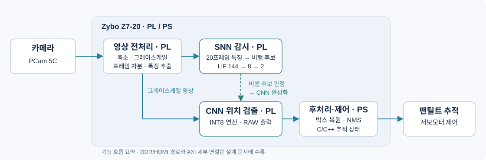

# FPGA 기반 드론 탐지·추적

드론이 드물게 나타나는 환경에서 **SNN으로 감시하고, 비행 후보가 잡히면 CNN으로 위치를 검출해 팬틸트로 추적**하는 시스템입니다. 카메라·영상 처리·AI 추론·제어를 Zybo Z7-20 한 보드에 연결해 외부 PC 없이 동작하는 시제품을 만들었습니다.

**종합설계 · 2026.03–06**

`Zynq-7020` · `Verilog` · `C/C++` · `AXI/VDMA` · `SNN` · `INT8 CNN`

## 시연

약 10초의 주요 장면입니다.

[시연·장면 안내·시제품·포스터](docs/demo.md)

[드론 감시·추적 영상 · 약 55초](media/demo.mp4)

## 전체 흐름

PL에서 영상 스트림과 반복 연산을 처리하고, PS에서 초기화·가중치 전송·검출 후처리·추적 상태를 관리합니다. 검출이 이어지지 않으면 감시 상태로 돌아갑니다.

## 핵심 설계와 문제 해결

- **표적이 있을 때 정밀 탐지:** 프레임 차분을 144개 특징으로 압축하고 20프레임의 움직임을 SNN으로 판단합니다. 후보가 나타나면 CNN을 실행해 위치를 구합니다.
- **하드웨어 연산과 소프트웨어 후처리 연결:** CNN의 RAW 출력을 PS에서 박스로 복원하고 NMS를 적용한 뒤 추적 명령으로 연결했습니다. 런타임 가중치 로드와 제어에는 AXI 인터페이스를 사용했습니다.
- **통합 문제를 단계별로 확인:** 검은 화면 문제를 초기화 로그·영상 메모리·프레임 동기로 나눠 추적했습니다. 정지 영상의 오분류는 all-zero RTL 시험으로 재현하고 signed 비트폭과 동률 판정을 점검했습니다.

## 주요 결과

| 항목 | 결과 |
|---|---|
| SNN 분류 | 정확도 98% · 최종보고서·포스터 기재값 |
| CNN 검출 | AP@0.5 89% · 처리율 약 37 FPS |
| FPGA 자원 | LUT 52.26% · BRAM 64.64% |
| 조건부 추론 | 출현율 1% 시나리오에서 **추론 추가 전류 약 42% 절감** |

전류 절감률은 카메라·HDMI 기준 부하를 제외한 추론 증가분의 비교입니다. 상태별 측정값에 출현율을 적용한 계산과 모델 평가 범위는 [결과와 측정 조건](docs/results.md)에 정리했습니다.

## 상세 자료와 코드

| 보고 싶은 내용 | 바로가기 |
|---|---|
| 영상·SNN·CNN·PS/PL 인터페이스 | [설계 구조](docs/architecture.md) |
| 검은 화면·데이터 분할·정지 영상·자원 문제 | [개발과 문제 해결](docs/development.md) |
| 성능 지표·측정값·절감률 계산 | [결과와 측정 조건](docs/results.md) |
| 초기화·RTL·추론 코드를 읽는 순서 | [핵심 코드 안내](docs/code-map.md) |
| Vivado·Vitis 구성과 버전별 재현 범위 | [개발 환경과 실행 안내](docs/reproduction.md) |
| 원본 프로젝트 | [팀 코드 저장소](https://github.com/jounget5411-lab/capstone_drone) |

공개 코드 `206404b`의 영상·SNN 경로와 이후 6월 최종 통합 내용을 구분해 설명했습니다. 버전 관계는 실행 안내에서 확인할 수 있습니다.

[← 전체 프로젝트 포트폴리오](https://github.com/jounget5411-lab/portfolio)
