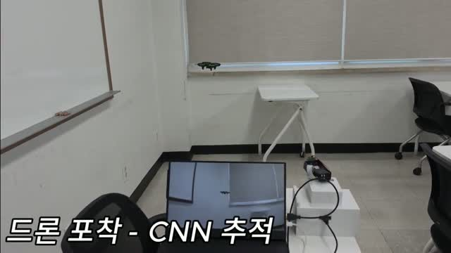
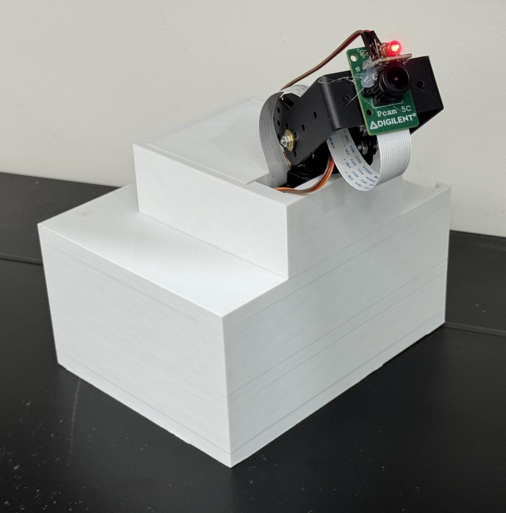
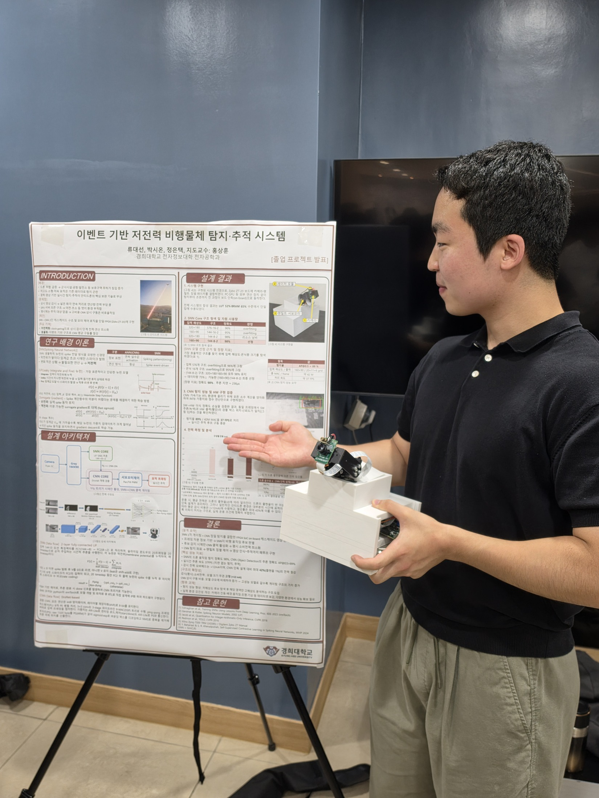

# 실제 시연과 포스터

[프로젝트 소개](../README.md) · [설계 상세](architecture.md) · [결과와 측정 조건](results.md)

## 장치 시연

사진을 누르면 약 55초의 실제 장치 시연 영상을 볼 수 있습니다. 모니터의 카메라 영상과 실물 장치를 함께 촬영했으며, 장면별 자막으로 감시와 추적 상태를 표시했습니다.

| 대표 영상의 구간 | 볼 수 있는 장면 |
|---|---|
| 약 00:02–00:08 | 정지한 실내 장면과 `평상시 - SNN 감시` 자막 |
| 약 00:14–00:39 | 실제 드론 비행, 모니터의 카메라 영상과 `드론 포착 - CNN 추적` 자막 |
| 약 00:45–00:51 | 사람이 통과하는 장면과 `CNN+추적 꺼짐` 표시 |

## 추가 시연

- [감시에서 드론 추적으로 전환하는 촬영본](../media/demo-2.mp4): 앞부분의 `SNN 감시` 자막과, 드론 비행 중 모니터 영상·`CNN 추적` 자막을 볼 수 있습니다.
- [드론 외 객체가 움직이는 촬영본](../media/demo-3.mp4): 사람이 이동하거나 손을 움직이는 장면과 `CNN+추적 꺼짐` 표시를 볼 수 있습니다.

시연 자료는 카메라·추론·후처리·팬틸트를 연결한 시제품의 동작을 소개합니다. FPGA의 영상 처리·추론 결과를 프로세서의 C/C++ 후처리와 추적 제어로 연결한 구성입니다.

모델 성능과 조건부 추론의 전류 비교는 [결과와 측정 조건](results.md)에 정리했습니다.

## 시제품

## 종합설계 포스터

포스터를 누르면 원본 크기로 볼 수 있습니다. 시스템 구성과 최종보고 지표를 함께 정리한 자료입니다.
